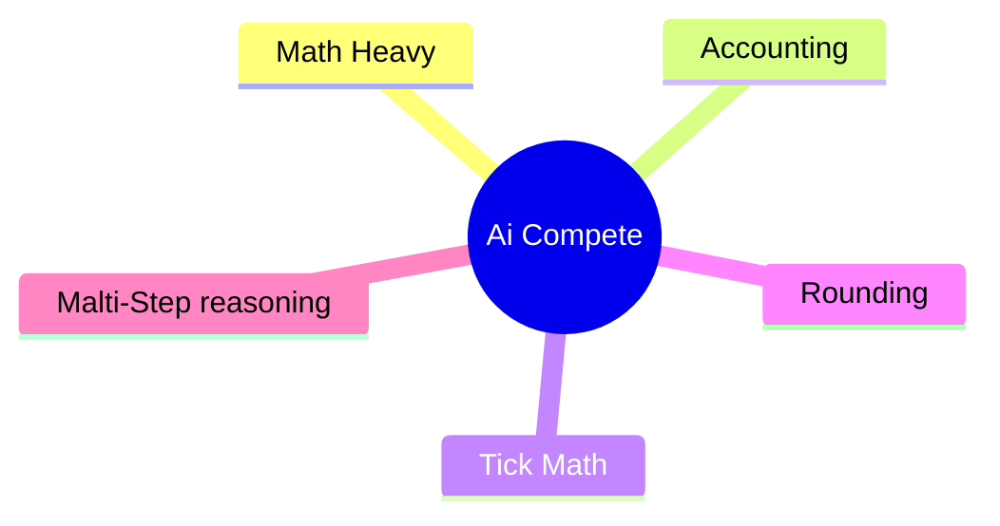
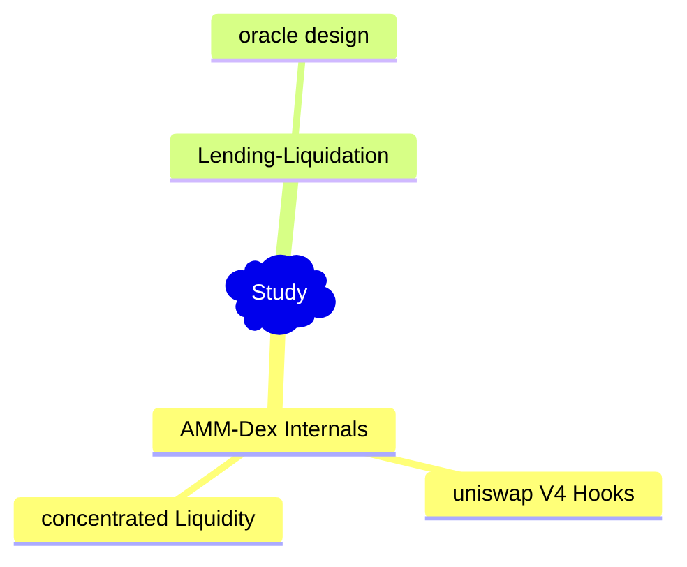
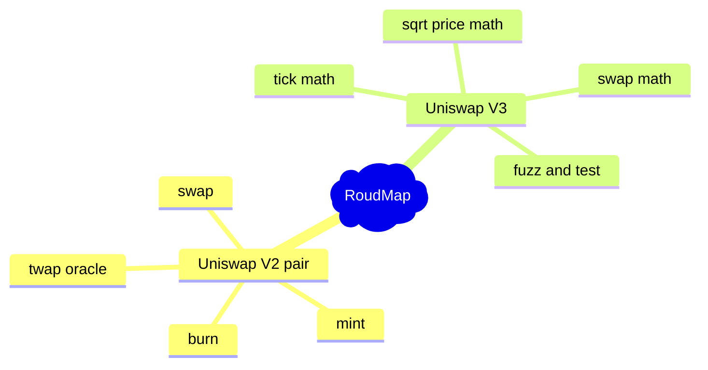

## Smart Contract Auditing Roadmap



# What I Have To Focus




# 90-Day Roadmap: AMM & Uniswap Security Research

## Goal

Build deep expertise in AMM mathematics, Uniswap V2/V3/V4 internals, DeFi exploit analysis, and smart contract security auditing.

**Primary objective:** Become capable of independently discovering, reproducing, testing, and reporting AMM-related vulnerabilities.

**Tech stack:** Solidity, Foundry, Git, GitHub, Fuzz Testing, Invariant Testing.

---

# Phase 1: AMM Fundamentals (Days 1–30)

## 1. Build Uniswap V2 Pair from Scratch

**Goal:** Understand AMM mechanics by implementing the core pair contract without copying the original implementation.

### Step 1.1 — Set Up the Project
- [ ] Create a GitHub repository: `amm-security-lab`.
- [ ] Initialize a Foundry project.
- [ ] Configure Solidity and the testing environment.
- [ ] Organize contracts, tests, and documentation.

### Step 1.2 — Implement the Core Pair
- [ ] Implement ERC-20 LP token functionality.
- [ ] Implement token reserves and reserve updates.
- [ ] Implement `mint()` for adding liquidity.
- [ ] Implement `burn()` for removing liquidity.
- [ ] Implement `swap()` with the constant-product invariant.
- [ ] Implement the fee calculation.
- [ ] Implement `sync()` and `skim()`.
- [ ] Implement safe token transfers and reentrancy protections where appropriate.

### Step 1.3 — Implement the TWAP Oracle
- [ ] Understand cumulative price tracking.
- [ ] Implement cumulative price updates.
- [ ] Implement timestamp tracking and timestamp overflow handling.
- [ ] Build a consumer that calculates a time-weighted average price.
- [ ] Test observations across multiple time intervals.
- [ ] Test manipulation scenarios involving short-term spot prices.

### Step 1.4 — Test and Validate
- [ ] Write unit tests for every external function.
- [ ] Test zero liquidity and insufficient liquidity.
- [ ] Test rounding and integer-division edge cases.
- [ ] Test fee-on-transfer and non-standard ERC-20 behavior.
- [ ] Write fuzz tests for swap and liquidity operations.
- [ ] Write invariant tests for the constant-product rule and reserve accounting.
- [ ] Compare behavior against the official Uniswap V2 implementation.

**Deliverable:** A working V2-style pair implementation with a TWAP oracle, documented mathematics, and automated tests.

---

## 2. Study Uniswap V3 Mathematics

**Goal:** Understand concentrated liquidity and independently implement its critical mathematical components.

### Step 2.1 — Read the Whitepaper
- [ ] Read the official Uniswap V3 whitepaper.
- [ ] Explain concentrated liquidity in your own words.
- [ ] Understand ticks, tick spacing, and liquidity positions.
- [ ] Understand the relationship between price and square-root price.
- [ ] Derive the liquidity equations for token0 and token1.
- [ ] Explain how liquidity changes across ticks.

### Step 2.2 — Study the Core Math Libraries
Read the source code and document each function's inputs, outputs, rounding direction, and assumptions.

- [ ] `TickMath`
- [ ] `SqrtPriceMath`
- [ ] `SwapMath`
- [ ] `FullMath`
- [ ] `LiquidityMath`
- [ ] `FixedPoint96`

For each library:

- [ ] Write a mathematical explanation.
- [ ] Identify precision and overflow constraints.
- [ ] Document rounding-up versus rounding-down behavior.
- [ ] Identify boundary conditions and potential failure modes.
- [ ] Implement the core mathematics independently in Solidity.

### Step 2.3 — Build a Testing Suite
- [ ] Write unit tests against known reference values.
- [ ] Test minimum and maximum supported ticks.
- [ ] Test minimum and maximum square-root prices.
- [ ] Test zero liquidity and zero-amount inputs.
- [ ] Test exact-input and exact-output swaps.
- [ ] Write fuzz tests for price and amount calculations.
- [ ] Write



```
Invariant = قاعدة لازم تفضل صحيحة مهما حصل من معاملات أو عمليات داخل الـ Smart Contract.
```


